<div align="center">

# Stockout-Aware Demand Forecasting & Newsvendor Ordering

### When a shelf runs empty, sales stop telling the truth.

**Forecasting fresh-retail demand that stockouts hide, turning it into order quantities, and putting the results in front of planners through a Power BI report, a Streamlit order planner and a 3D web simulator.**

[](#-power-bi-report)
[](requirements.txt)
[](planner/pipeline.py)
[](#-streamlit-order-planner)
[](#-3d-stockout-simulator)
[](planner/sql/schema.sql)
[](paper/main.pdf)
[-orange)](https://huggingface.co/datasets/Dingdong-Inc/FreshRetailNet-50K)

[Power BI report](#-power-bi-report) ·
[Order planner](#-streamlit-order-planner) ·
[3D simulator](#-3d-stockout-simulator) ·
[Research pipeline](#-research-pipeline) ·
[Results](#-results) ·
[Quickstart](#-quickstart) ·
[Paper](paper/main.pdf)

<br/>

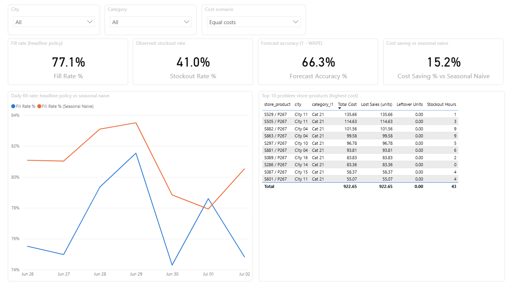

<sub><i>Power BI report, page 1 (Executive overview): network KPIs, daily fill rate against the seasonal-naive baseline, and the 10 highest-cost store-products.</i></sub>

</div>

---

## 📌 At a glance

| | |
|---|---|
| **Problem** | Recorded sales understate demand whenever a product sells out. **44.0%** of store-product-days in the sample have at least one empty-shelf hour. |
| **Data** | [FreshRetailNet-50K](https://huggingface.co/datasets/Dingdong-Inc/FreshRetailNet-50K): 50,000 store-product series, 90 + 7 days, hourly sales **and** hourly stockout flags (4.85 M rows) |
| **Models** | LightGBM demand quantiles (q25–q90), pooled conformal calibration, TimesNet, TFT, Kaplan-Meier, seasonal naive |
| **Decision** | Newsvendor order at the critical ratio β = c<sub>u</sub> / (c<sub>u</sub> + c<sub>o</sub>), with 9 ordering policies under 3 cost ratios |
| **Headline (Power BI / planner)** | **−15.2% ordering cost** and **−47.7% leftover units** against the seasonal-naive rule on the held-out week (20,641 full-stock store-product-days) |
| **Headline (paper)** | Training on a different stockout mechanism raises the calibrated policy's cost by **at most +0.0472** (95% CI 0.0391–0.0554), the smallest worst case among the policies that read the evaluation history |
| **Deliverables** | Power BI report (5 pages + tooltip, 50 DAX measures, RLS) · Streamlit app · 3D React/Node simulator · PostgreSQL warehouse · IEEE-format paper · project report |

---

## 🧩 The problem

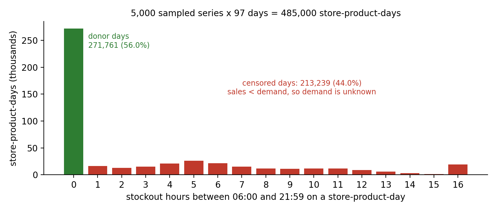

On a day with no stockout between 06:00 and 21:59 (a **donor day**), recorded sales equal demand. On the other **44%** of days the shelf ran empty, so sales are only a lower bound on demand. A model fitted to raw sales learns the store's past stocking decisions as well as customer demand, and its orders keep repeating the same shortages.

This project:

1. **Measures demand where it is observable.** Donor days give an exact, though selected, demand target.
2. **Simulates stockouts on purpose.** Three censoring mechanisms (A ordinary depletion, B promotion-sensitive, C sustained scarcity) hide demand in different ways, so a model trained on one censored history can be scored on another against the same true outcomes.
3. **Turns forecasts into decisions.** Quantile forecasts become newsvendor orders, and fill rate, waste and cost are compared across 9 policies.
4. **Ships the results.** A Power BI report for managers, a Streamlit planner for daily ordering, and a 3D simulator that explains the problem to anyone.

---

## 🏗️ Architecture

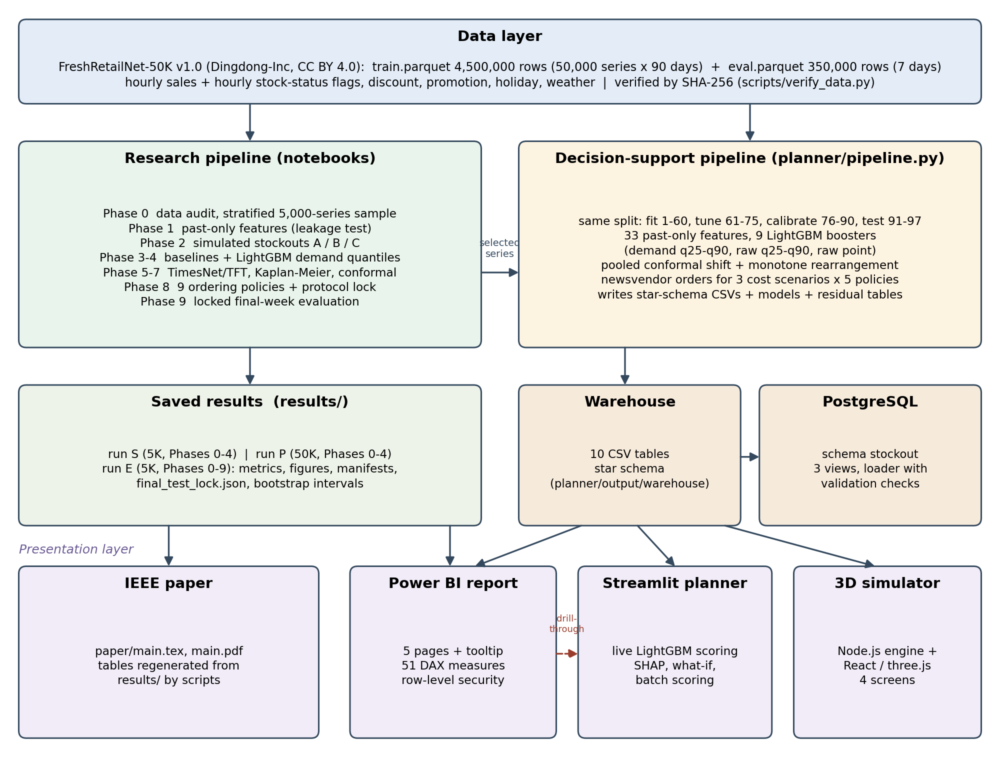

| Layer | Component | Location |
|---|---|---|
| Research | Phase 0–9 notebooks, saved runs S / P / E, locked final-week evaluation | [`notebooks/`](notebooks), [`results/`](results) |
| Decision support | Feature pipeline, 9 LightGBM boosters, conformal shift, newsvendor orders, star-schema export | [`planner/pipeline.py`](planner/pipeline.py) |
| Warehouse | 10-table star schema, PostgreSQL schema + views, loader with 14 validation checks | [`planner/sql/`](planner/sql), [`planner/load_postgres.py`](planner/load_postgres.py) |
| **BI** | **Power BI project (PBIP / TMDL / PBIR), generated from code** | [`planner/powerbi/`](planner/powerbi) |
| Apps | Streamlit order planner · 3D web simulator (Node.js engine + React / three.js) | [`planner/app.py`](planner/app.py), [`simulator/`](simulator) |
| Publication | IEEE-format paper, tables regenerated from `results/` · full project report | [`paper/`](paper), [`report/`](report) |

---

## 📊 Power BI report

> The Power BI report is the main business-facing deliverable. Supply-planning managers use it to see how often shelves run empty, how accurate the forecasts are, and which ordering policy costs least at their own shortage-to-waste cost ratio.

The report is a **Power BI Project (`.pbip`)**, with a TMDL semantic model and a PBIR report definition. It is **generated entirely from code** by [`planner/powerbi/build_pbip.py`](planner/powerbi/build_pbip.py), so every page, visual, measure, relationship and role is version-controlled and can be diffed in pull requests.

| | |
|---|---|
| **Pages** | 5 report pages + 1 tooltip page, with drill-through |
| **Visuals** | 45 (19 cards, 11 slicers, 5 line charts, 5 tables, 3 bar charts, 1 matrix heatmap, 1 scatter) |
| **Semantic model** | Star schema: 5 dimensions, 4 fact tables, 10 one-to-many single-direction relationships, Import mode |
| **DAX** | 50 measures in 5 display folders, including time intelligence, a what-if parameter, RANKX and baseline comparisons |
| **Security** | Static and dynamic row-level security (RLS) by city |
| **Theme** | Custom JSON theme ([`theme.json`](planner/powerbi/theme.json)) |

### Page 1 · Executive overview
*"Are we serving demand, and is the new policy cheaper than what we do today?"*


- **KPI cards:** fill rate of the headline policy, observed stockout rate, forecast accuracy (1 − WAPE) and cost saving against seasonal naive (**15.2%**).
- **Daily fill-rate trend** of the headline policy against the seasonal-naive baseline over the held-out week.
- **Top-10 problem store-products** by total cost. All ten are product **P267**, which is how the insight memo below was found.
- **Slicers** for city, category and cost scenario (excess stock more costly / equal costs / shortage more costly).

### Page 2 · Forecast accuracy
*"How close are the forecasts, and are the uncertainty bands calibrated?"*

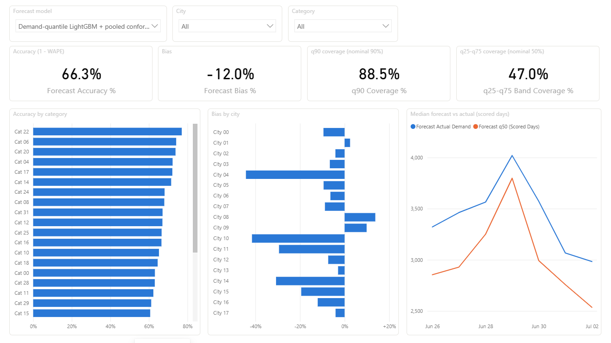

- **Accuracy 66.3%**, **bias −12.0%**, **q90 coverage 88.5%** (nominal 90%) and **q25–q75 coverage 47.0%** (nominal 50%).
- Accuracy ranked by category, bias by city as a diverging bar chart, and median forecast against actual demand on scored days.
- The **model slicer** switches the whole page between the 5 forecast models.

### Page 3 · Stockouts & service
*"Where and when do shelves run empty?"*

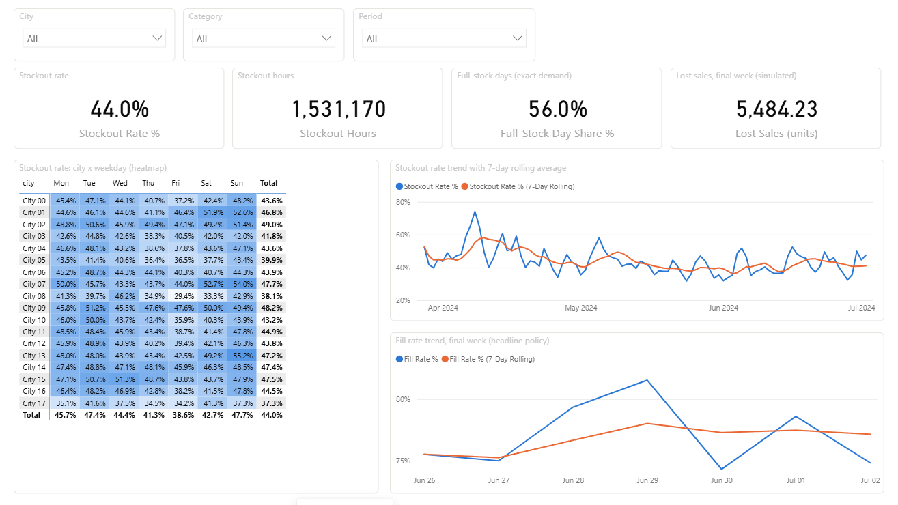

- **44.0% stockout rate**, **1.53 M stockout hours**, 56.0% full-stock days and simulated lost sales for the final week.
- **City × weekday heatmap** (conditional-format matrix). City 02 is the worst city at 49.0%, and Sundays and Tuesdays are the worst days.
- **7-day rolling stockout rate** over all 97 days (`DATESINPERIOD`) and the fill-rate trend for the final week.

### Page 4 · Policy comparison
*"Which ordering policy should we use at our cost ratio?"*

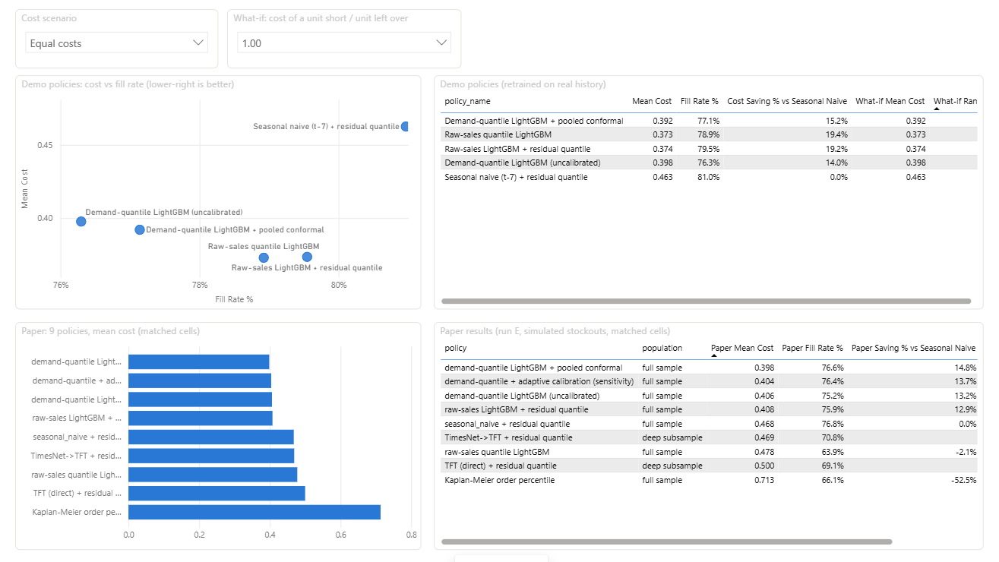

- **Cost against fill-rate scatter** for the 5 demo policies. Lower-right is better.
- **What-if parameter:** slide the shortage-to-leftover cost ratio from 0.25 to 5. `What-if Mean Cost` re-scores every policy and `What-if Rank` (RANKX) re-orders them live.
- **The paper's 9-policy results** (run E, simulated stockouts, matched train/test cells) next to the demo policies.

### Page 5 · Store-product drill-through
*"Why did this store-product cost so much?"*

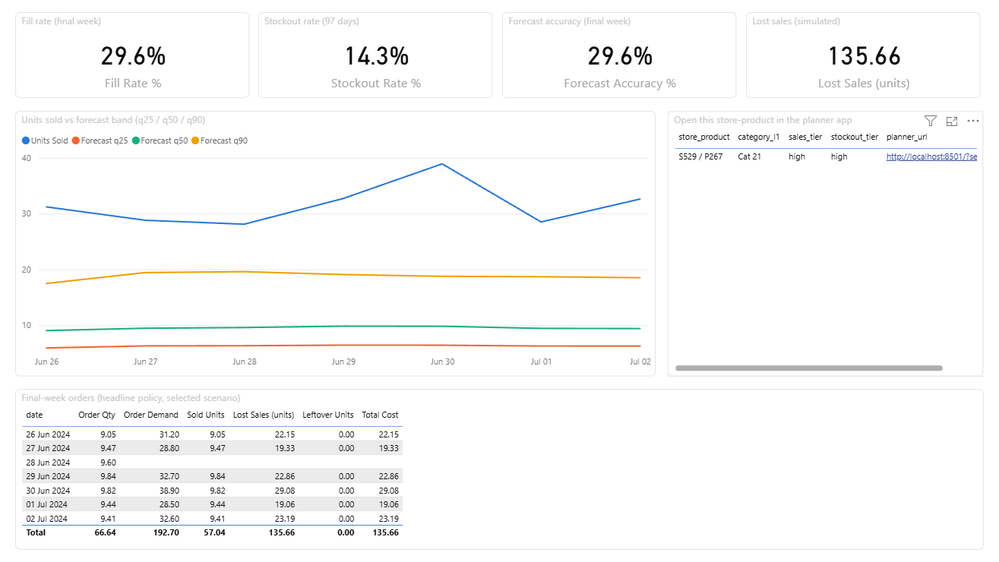

- Right-click any store-product on another page and choose **Drill through**. The page shows units sold against the q25 / q50 / q90 forecast band, plus the final-week order book (order, demand, sold, lost sales, leftover, cost).
- A **`planner_url` link** opens the same store-product in the Streamlit planner (`?series=…`), so the report connects to the live model.
- A hidden **tooltip page** shows KPI cards when you hover over visuals on other pages.

### Data model

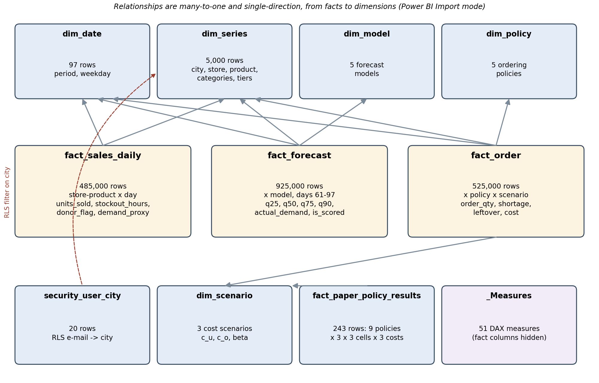

| Table | Grain | Rows |
|---|---|---:|
| `fact_sales_daily` | store-product × day | 485,000 |
| `fact_forecast` | store-product × day × model (days 61–97) | 925,000 |
| `fact_order` | store-product × day × policy × scenario (final week) | 525,000 |
| `fact_paper_policy_results` | scenario × policy × train mechanism × test history | 243 |
| `dim_date` · `dim_series` · `dim_model` · `dim_policy` · `dim_scenario` | conformed dimensions | 97 · 5,000 · 5 · 5 · 3 |
| `security_user_city` | RLS mapping (user e-mail → city) | 20 |

`dim_date` is marked as the date table. Technical keys and raw fact columns are hidden, so report authors work only with the measures in `_Measures`.

### DAX highlights

The 50 measures are grouped into **1 Sales & stockouts · 2 Forecast · 3 Orders · 4 What-if · 5 Paper (9 policies)**. A few examples:

```dax
-- Baseline comparison: saving of the selected policy against seasonal naive in the same filter context
Mean Cost (Seasonal Naive) =
    CALCULATE ( [Mean Cost], REMOVEFILTERS ( dim_policy ), dim_policy[policy_key] = 5 )

Cost Saving % vs Seasonal Naive =
    IF ( NOT ISBLANK ( [Mean Cost] ), 1 - DIVIDE ( [Mean Cost], [Mean Cost (Seasonal Naive)] ) )

-- What-if: re-price shortages with the slider value and rank the policies live
What-if Mean Cost =
    DIVIDE ( [Lost Sales (units)] * [Shortage Cost Ratio Value] + [Leftover Units], [Scored Order Days] )

What-if Rank =
    IF ( HASONEVALUE ( dim_policy[policy_name] ),
         RANKX ( ALLSELECTED ( dim_policy[policy_name] ), [What-if Mean Cost], , ASC, DENSE ) )

-- Time intelligence
Stockout Rate % (7-Day Rolling) =
    CALCULATE ( [Stockout Rate %], DATESINPERIOD ( dim_date[date], MAX ( dim_date[date] ), -7, DAY ) )
```

### Row-level security

| Role | Type | Filter on `dim_series` |
|---|---|---|
| `City 00 Manager (demo)` | static | `[city] = "City 00"` |
| `City Manager` | dynamic | `[city] IN CALCULATETABLE ( VALUES ( security_user_city[city] ), security_user_city[user_email] = USERPRINCIPALNAME () )` |

To test it in Power BI Desktop, go to **Modeling → View as**, pick `City Manager` and set *Other user* = `manager.city03@example.com`. The e-mail addresses are placeholders.

<details>
<summary><b>KPI dictionary (click to expand)</b></summary>

| KPI (DAX measure) | Business question | Formula | Caveats |
|---|---|---|---|
| Fill Rate % | What share of demand did we serve? | Σ min(order, demand) / Σ demand | Scored (full-stock) days only |
| Stockout Rate % | How often do shelves run empty? | days with ≥1 stockout hour / all days | Real recorded data, 06:00–21:59 |
| Forecast Accuracy % | How close is the median forecast? | 1 − Σ\|q50 − actual\| / Σ actual | Scored days; headline model by default |
| Forecast Bias % | Do we over- or under-forecast? | (Σ q50 − Σ actual) / Σ actual | Negative = under-forecast |
| q90 Coverage % | Is the upper band reliable? | share of days with actual ≤ q90 | Nominal 90% |
| q25–q75 Band Coverage % | Is the central band calibrated? | share of days with q25 ≤ actual ≤ q75 | Nominal 50% |
| Mean Cost | What does the policy cost per day? | Σ (c<sub>u</sub>·shortage + c<sub>o</sub>·leftover) / scored days | Relative units (no prices in the data) |
| Cost Saving % vs Seasonal Naive | How much better than today's rule? | 1 − Mean Cost / Mean Cost (seasonal naive) | Same scenario and filters |
| Lost Sales (units) | How much demand went unserved? | Σ max(demand − order, 0) | Simulated from orders |
| Leftover Share % | How much of what we order is wasted? | Σ leftover / Σ order | No carry-over (fresh goods) |
| What-if Mean Cost / Rank | Which policy wins at another cost ratio? | (ratio·shortage + leftover) / days; RANKX | Orders are re-scored, not re-optimised |
| … (7-Day Rolling), WoW Change | Is it improving? | DATESINPERIOD / DATEADD over `dim_date` | Daily grain |
| Paper Mean Cost / Saving % | What did the paper find? | average over train/test cells | Simulated censoring |

The full KPI and data dictionaries are in [`planner/README.md`](planner/README.md).
</details>

**Open it:** run the pipeline (see [Quickstart](#-quickstart)), then open [`planner/powerbi/StockoutPlanner.pbip`](planner/powerbi/StockoutPlanner.pbip) in Power BI Desktop and click **Refresh now** in both yellow bars. The CSV location is the `DataFolder` parameter (*Transform data → Manage parameters*). PostgreSQL can be used as an alternative source.

---

## 🖥️ Streamlit order planner

An interactive planner app that **scores the saved LightGBM models live** for any store, product and day in the held-out week.

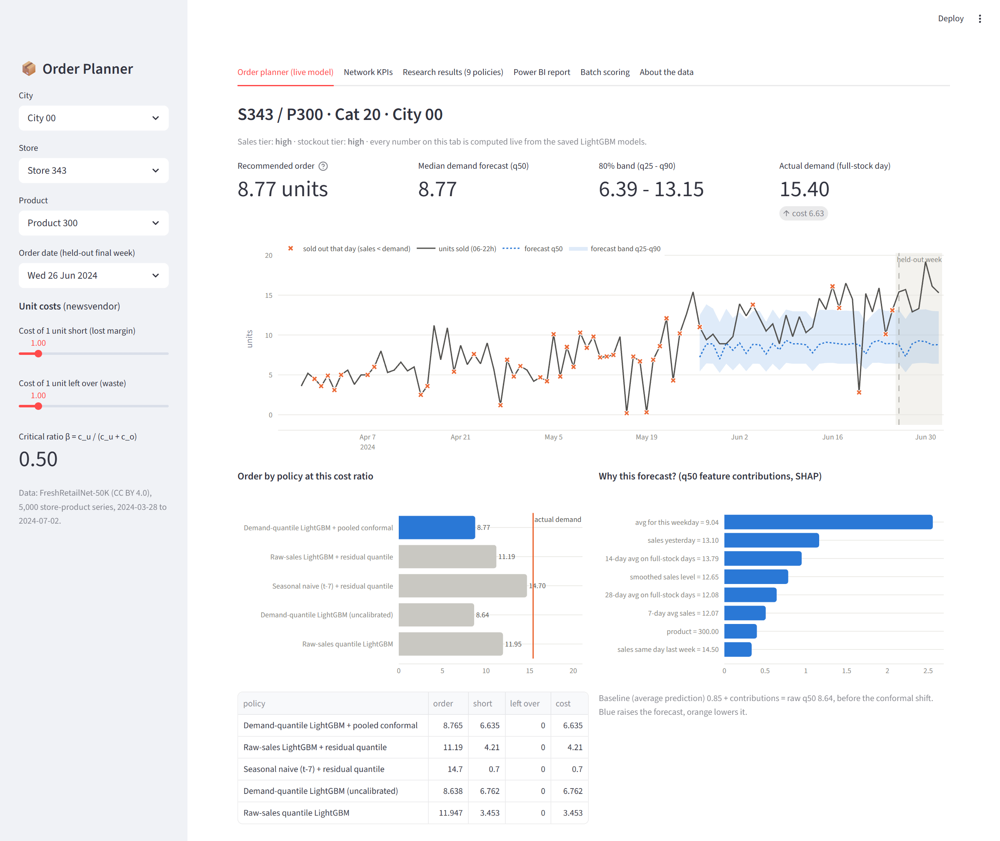

| Tab | What it does |
|---|---|
| **Order planner (live model)** | q25–q90 forecast band, the recommended newsvendor order at your own unit costs, the order each policy would place, and a **SHAP** breakdown of the forecast |
| **Network KPIs** | Fill rate, stockout rate, accuracy and cost saving, a cost-vs-fill-rate chart, a what-if re-scoring and the top-10 problem store-products with links back to the planner |
| **Research results** | The paper's 9-policy comparison with a what-if cost ratio |
| **Power BI report** | Report screenshots, or the live report through a *Publish to web* URL |
| **Batch scoring** | Upload `store_id, product_id, date` and download the recommended orders |

<table>
<tr>
<td width="50%">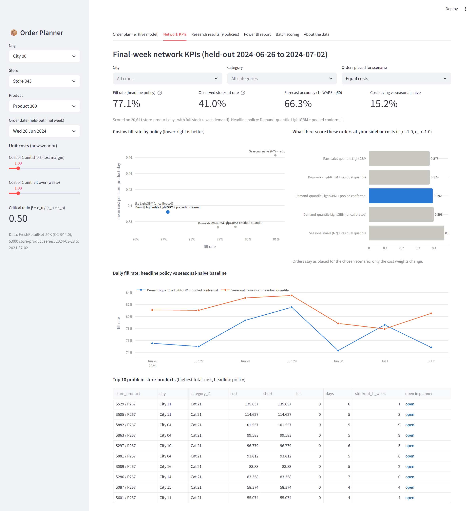<br/><sub>Network KPIs</sub></td>
<td width="50%">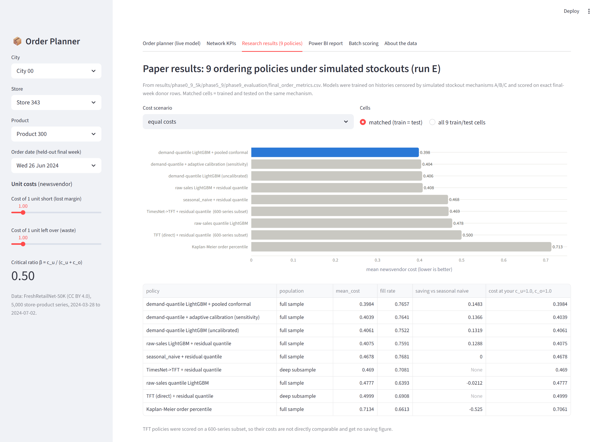<br/><sub>Research results (9 policies)</sub></td>
</tr>
<tr>
<td width="50%">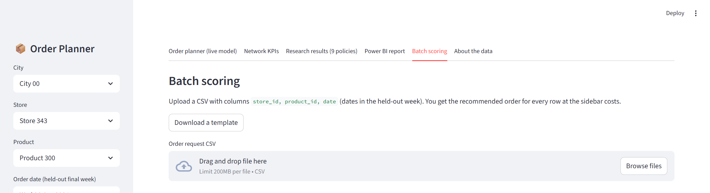<br/><sub>Batch scoring</sub></td>
<td width="50%">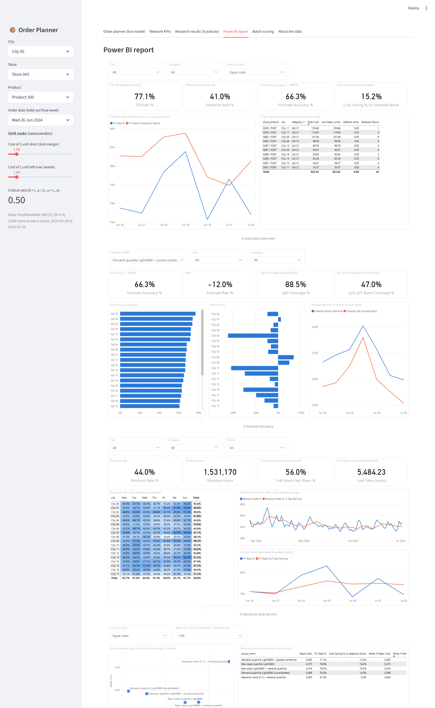<br/><sub>Power BI report tab</sub></td>
</tr>
</table>

The app's live predictions match the stored forecasts to within 5e-5 (CSV rounding).

---

## 🎮 3D stockout simulator

A web app that runs the project's trained models **in a Node.js engine without calling Python**. It re-implements LightGBM inference, the 33-feature builder, conformal calibration, the newsvendor rule and the paper's stockout simulator in JavaScript, and checks the results against Python.

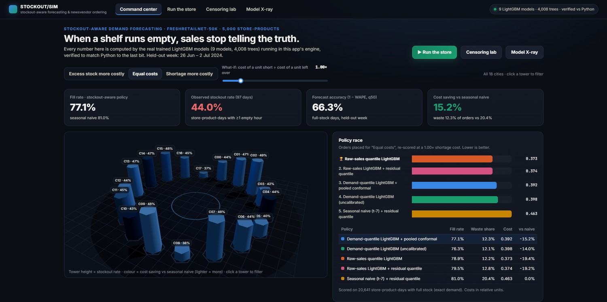

| Screen | What you do |
|---|---|
| **Command center** | Drag the shortage/waste cost ratio and click a city tower. 18 cities appear as 3D towers (height = stockout rate, colour = cost saving), with a live policy race. |
| **Run the store** (game) | Pick a real store and set the order for every shelf each morning of the held-out week. Customers arrive following each product's **real hourly demand**, and your cost is scored against the AI and the baselines. |
| **Censoring lab** | Apply stockout mechanisms A / B / C or force stockouts by hand, then watch how much demand is hidden and how each model's forecast shifts. |
| **Model X-ray** | Drag any of the 33 model inputs. All 5 models re-score instantly, and the q50 model is drawn as a 3D forest of 208 trees with TreeSHAP contributions. |

<table>
<tr>
<td width="50%">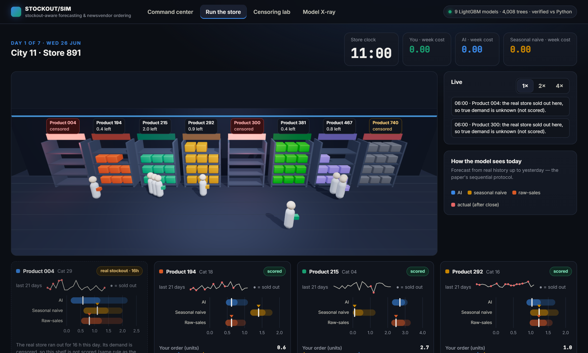<br/><sub>Run the store: a 3D store driven by real hourly demand</sub></td>
<td width="50%">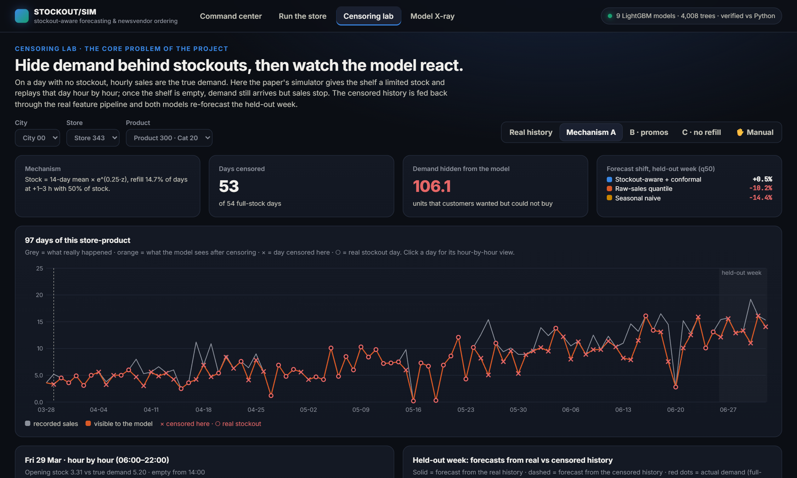<br/><sub>Censoring lab: hide demand behind stockouts</sub></td>
</tr>
<tr>
<td width="50%">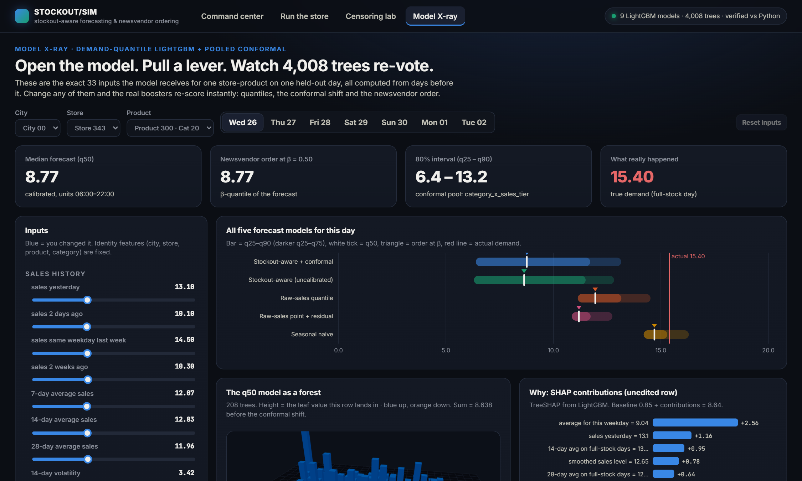<br/><sub>Model X-ray: 4,008 trees re-scored live</sub></td>
<td width="50%">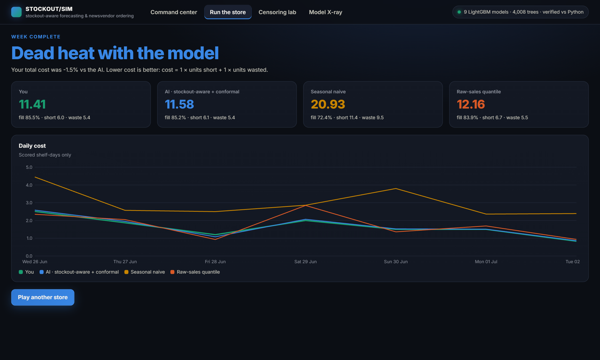<br/><sub>End-of-week score: you vs the AI vs the baselines</sub></td>
</tr>
</table>

**Exactness check** (`npm run verify`, 3,000 rows):

```
[PASS] features: 3000 rows x 33 features, 0 mismatches
[PASS] booster scores: 9 models, max |JS - Python| = 0.00e+0
[PASS] final quantiles vs warehouse: 2433 rows x 5 models x 4 quantiles, max diff = 5.00e-5   (CSV rounding)
```

Stack: Node.js + Express, React 18 + Vite, three.js via @react-three/fiber and drei, zustand, hand-written SVG charts. A presenter guide with a 10-minute demo script is in [`simulator/docs/Stockout_Simulator_Guide.pdf`](simulator/docs/Stockout_Simulator_Guide.pdf).

---

## 🔬 Research pipeline

The research is a 10-phase notebook pipeline with a **pre-registered protocol**: every check and policy was frozen in a lock file (`final_test_lock.json`) **before** the final week was scored, and the final week was scored once.

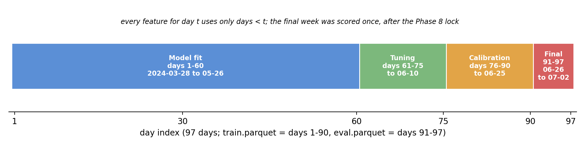

| Phase | What happens |
|---|---|
| **0** | Data audit, temporal protocol, stratified 5,000-series sample |
| **1** | Past-only features, with a leakage perturbation test |
| **2** | Simulated stockout mechanisms A / B / C, fitted to real stockout patterns |
| **3–4** | Conventional baselines; 12 frozen LightGBM demand-quantile models |
| **5** | TimesNet recovery of hidden hours (290,397 donor hours) and 24 TFT pipelines |
| **6** | Kaplan-Meier censored-demand estimator (8/8 unit tests, 207 pools) |
| **7** | Pooled conformal calibration (513,276 residuals) with monotone rearrangement |
| **8** | 9 ordering policies, 10/10 hand tests, then the **protocol lock** |
| **9** | Locked final-week evaluation: 3×3 train/test transfer cells × 3 cost ratios, paired cluster bootstrap over 866 stores |

<p align="center">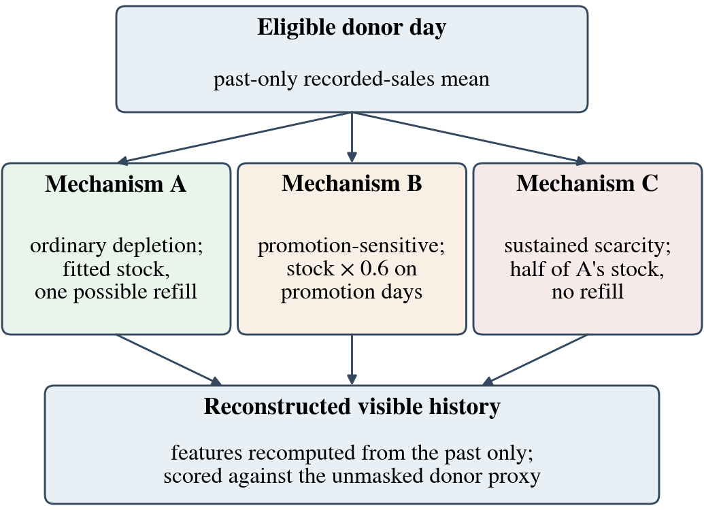</p>

| Run | Scope | Phases | Runtime | Peak RAM |
|---|---|---|---:|---:|
| **S** | 5,000 series | 0–4 | 1,194.9 s | 1.29 GB |
| **P** | all 50,000 series | 0–4 | 4,210.4 s | 6.11 GB |
| **E** | 5,000 series (600 for deep models) | 0–9, complete | 1,483.8 s + 10,786 s | 5.06 GB |

---

## 📈 Results

### Paper: 9 policies under simulated stockouts (run E, equal costs, matched cells)

| Policy | Mean cost ↓ | Fill rate | Saving vs seasonal naive |
|---|---:|---:|---:|
| **Demand-quantile LightGBM + pooled conformal** | **0.398** | 76.6% | **14.8%** |
| Demand-quantile + adaptive calibration (sensitivity) | 0.404 | 76.4% | 13.7% |
| Demand-quantile LightGBM (uncalibrated) | 0.406 | 75.2% | 13.2% |
| Raw-sales LightGBM + residual quantile | 0.408 | 75.9% | 12.9% |
| Seasonal naive + residual quantile | 0.468 | 76.8% | 0.0% |
| TimesNet → TFT + residual quantile *(600-series subset)* | 0.469 | 70.8% | – |
| Raw-sales quantile LightGBM | 0.478 | 63.9% | −2.1% |
| TFT (direct) + residual quantile *(600-series subset)* | 0.500 | 69.1% | – |
| Kaplan-Meier order percentile | 0.713 | 66.1% | −52.5% |


<sub>Mean cost of the pooled-conformal policy for each train mechanism (rows) × test history (columns) under the three cost ratios.</sub>

**Key findings**

- **No policy wins under every cost ratio.** When a shortage costs 3× a leftover, LightGBM demand quantiles with pooled conformal calibration are the cheapest full-sample policy in **all 9** train/test cells. When leftovers cost more, a raw-sales LightGBM with residual quantiles is cheapest in all 9.
- **Robust to the type of stockout.** Training on a different mechanism raises the calibrated policy's cost by at most **+0.0472**, the smallest worst case among the policies that read the evaluation history.
- **Paired contrast against raw-sales LightGBM** (61,923 matched rows, 95% CI): **−0.0790** [−0.0946, −0.0615] when shortage is more costly, −0.0091 [−0.0204, 0.0052] at equal costs, and +0.0208 [0.0016, 0.0432] when excess stock is more costly.
- **Real censored days:** the q90 definite-miss lower bound is 7.2–9.0% over 105,000 final-week forecasts.

### Business insight memo (from the Power BI report)

1. **The calibrated model cuts ordering cost by 15.2% and waste by 47.7%** (leftover units 4,981 → 2,607) against the seasonal-naive rule. Fill rate drops from 81.0% to 77.1% because the baseline over-orders.
2. **Stockouts are frequent and concentrated.** The rate ranges from 37.3% (City 17) to 49.0% (City 02). Sundays (47.7%) and Tuesdays (47.4%) are the worst days.
3. **One item drives 12% of the cost.** Product P267 is 0.2% of store-products but 11.9% of the headline policy's cost, and its median forecast is 64% below demand. It should go on a manual-review list.

More detail: [`docs/results.md`](docs/results.md) · [`planner/README.md`](planner/README.md) · [paper](paper/main.pdf).

---

## 🚀 Quickstart

```bash
git clone https://github.com/Aman10n/-Stockout-Aware-Demand-Forecasting-and-Newsvendor-Ordering.git stockout-forecasting
cd stockout-forecasting
```

**1. Get the data.** Download v1.0 of [FreshRetailNet-50K](https://huggingface.co/datasets/Dingdong-Inc/FreshRetailNet-50K) to `data/train.parquet` and `data/eval.parquet`, then verify it:

```bash
python scripts/verify_data.py
```

| File | Rows | SHA-256 |
|---|---:|---|
| `train.parquet` | 4,500,000 | `6706832db892bbae4969c19d87e07975d2543d2ba7d7d4756360654785de5a3d` |
| `eval.parquet` | 350,000 | `1b118840664280c6b88bffc84c80ee1f54c05d911e354b7599e5da10995e960e` |

**2. Planner pipeline, Power BI and Streamlit** (Python 3.11+):

```bash
pip install -r planner/requirements.txt
python planner/pipeline.py               # ~2 min: trains models, writes planner/output/
python planner/powerbi/build_pbip.py     # writes the Power BI project
python -m streamlit run planner/app.py   # http://localhost:8501
```

Then open `planner/powerbi/StockoutPlanner.pbip` in Power BI Desktop and click **Refresh now**.

**3. Optional PostgreSQL warehouse:**

```bash
docker run -d --name stockout-pg -e POSTGRES_PASSWORD=stockout -p 5432:5432 postgres:16
python planner/load_postgres.py          # loads all tables and runs 14 validation checks
```

**4. 3D simulator** (Node 18+):

```bash
cd simulator
npm install
npm run export    # exports models, hourly panel and SHAP from Python
npm run verify    # JavaScript engine vs Python
npm run build
npm start         # http://localhost:3000
```

**5. Research notebooks.** Install the pinned packages with `pip install -r requirements.txt jupyterlab`, set the environment variables below and open a notebook in [`notebooks/`](notebooks):

```powershell
$env:FRN_DATA_DIR   = (Resolve-Path .\data).Path
$env:FRN_OUTPUT_DIR = (Join-Path (Get-Location) 'results\runs\phase0_4_demo')
$env:FRN_FULL_RUN   = '0'
$env:FRN_SAMPLE_N   = '5000'
jupyter lab
```

**6. Rebuild the paper's tables and figures** from the saved results (no retraining):

```bash
pip install -r paper/scripts/requirements.txt
python paper/scripts/make_exhibits.py
python paper/scripts/make_diagrams.py
cd paper && latexmk -pdf main.tex
```

---

## 📁 Repository structure

```text
.
├── planner/                     Decision-support layer
│   ├── pipeline.py              features → LightGBM q25–q90 → conformal → newsvendor orders → star schema
│   ├── app.py                   Streamlit order planner (live scoring, SHAP, what-if, batch)
│   ├── powerbi/                 ⭐ Power BI project (PBIP: TMDL model + PBIR report), theme, screenshots
│   │   └── build_pbip.py        generates the whole report from code
│   ├── sql/schema.sql           PostgreSQL star schema and views
│   └── load_postgres.py         warehouse loader with validation checks
├── simulator/                   3D web app
│   ├── server/engine/           JavaScript LightGBM, features, policies, stockout simulator
│   ├── web/src/                 React + three.js front end (4 screens)
│   └── docs/                    presenter guide, slide deck, screenshots
├── notebooks/                   Phase 0–4 and Phase 0–9 research notebooks
├── results/                     saved runs S (5K), P (50K), E (complete 0–9)
├── paper/                       IEEE-format manuscript, tables, figures, generator scripts
├── report/                      full project report (PDF / DOCX) and its build scripts
├── docs/results.md              verified results summary
├── scripts/                     dataset preview and checksum verification
└── data/                        dataset location (not tracked)
```

---

## ⚠️ Limitations

- Observed sales are not uncensored demand. Donor days are a **selected** demand proxy (quieter days are over-represented), so accuracy and cost figures cover full-stock days only.
- The complete Phase 0–9 run covers 5,000 series, and TimesNet / TFT use a 600-series subset. The 50,000-series run covers Phases 0–4.
- The Power BI, Streamlit and simulator demo models are retrained on the **real recorded** history. On that history the raw-sales models are as good as the stockout-aware ones (0.373 vs 0.392 at equal costs). The stockout-aware advantage appears under the simulated censoring mechanisms (report page 4).
- Costs are in relative units because the dataset has no prices. Lost sales are simulated from orders, not recorded.
- The official upstream baseline was reproduced only in part.

---

## 👥 Authors

**Akshara Kumari · Aman Koley · Shivam Singh · G. Premalatha**
Department of Data Science and Business Systems, School of Computing, SRM Institute of Science and Technology, Kattankulathur, India

If you use this work, please cite it using [`CITATION.cff`](CITATION.cff) (GitHub's *Cite this repository* button).

## 📄 License & data

The FreshRetailNet-50K dataset is distributed by Dingdong-Inc under **CC BY 4.0** and is **not** redistributed here.
