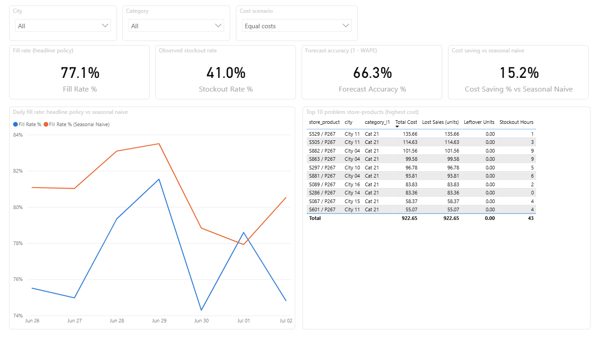
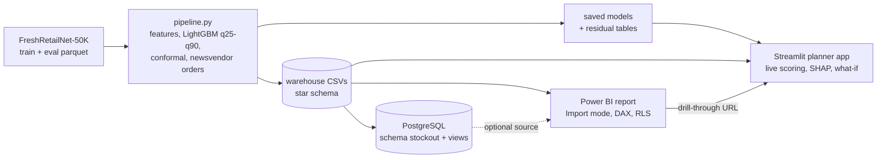

# Stockout-Aware Order Planner

An interactive front end and a Power BI report for the stockout-aware demand forecasting and newsvendor
ordering pipeline in this repository. Planners use it to see what to order for each store-product, and
managers use it to see how service, waste and cost compare across ordering policies.

| Deliverable | Where |
|---|---|
| Model pipeline (LightGBM quantiles + pooled conformal + newsvendor orders) | [pipeline.py](pipeline.py) |
| Interactive planner app (live model scoring, SHAP, what-if, batch scoring) | [app.py](app.py) |
| Power BI report, 5 pages + tooltip page, DAX measures, RLS | [powerbi/StockoutPlanner.pbip](powerbi/StockoutPlanner.pbip) |
| PostgreSQL star schema, views, loader with validation checks | [sql/schema.sql](sql/schema.sql), [load_postgres.py](load_postgres.py) |
| KPI dictionary, data dictionary, insight memo | this file |



## Architecture



## Run it

Run these from the repository root on Windows. You need Python 3.11+ and the dataset in `data/`; check it with `python scripts/verify_data.py`.

```powershell
pip install -r planner/requirements.txt
python planner/pipeline.py                 # about 2 minutes: trains models, writes planner/output/
python planner/powerbi/build_pbip.py       # writes the Power BI project
python -m streamlit run planner/app.py     # opens http://localhost:8501
```

**Power BI:** open `planner/powerbi/StockoutPlanner.pbip` in Power BI Desktop. If the cards show
"(Blank)", click **Refresh now** in the yellow bar; there are two bars, so click both. The CSV folder is set in
*Transform data → Manage parameters → DataFolder*. If you move the repository, run `build_pbip.py`
again or edit that parameter.

**PostgreSQL (optional):**

```powershell
docker run -d --name stockout-pg -e POSTGRES_PASSWORD=stockout -p 5432:5432 postgres:16
python planner/load_postgres.py            # loads all tables and runs 14 validation checks
```

**Row-level security:** in Power BI Desktop, go to *Modeling → View as*. Pick `City 00 Manager (demo)`, or pick
`City Manager` with *Other user* = `manager.city03@example.com`. The mapping lives in
`security_user_city.csv`. The e-mails are placeholders.

## What the app does

1. **Order planner (live model).** Pick a store, a product and a day in the held-out week, then set the unit cost
   of a shortage and of a leftover. The app scores the saved LightGBM models live and applies the conformal
   shift. It then shows the q25-q90 forecast band, the newsvendor order at the critical ratio
   β = c_u / (c_u + c_o), the order each policy would place, and a SHAP breakdown of the forecast.
2. **Network KPIs.** This tab shows fill rate, stockout rate, forecast accuracy and cost saving, filtered by city
   and category. It also shows a cost-vs-fill-rate chart, a what-if re-scoring at your cost ratio, and the top
   10 problem store-products, each with a link back to the planner.
3. **Research results.** This tab shows the paper's 9-policy comparison (run E), with a what-if cost ratio.
4. **Power BI report.** This tab shows report screenshots, or the live report if you add a *Publish to web*
   URL in `planner/config.json`.
5. **Batch scoring.** Upload `store_id, product_id, date` and download the recommended orders.

## Insight memo

**To:** supply planning manager. **Data:** 5,000 store-products, held-out week 26 Jun - 2 Jul 2024.
**Scope:** scored on 20,641 full-stock store-product-days.

**Findings**

1. **The model cuts ordering cost by 15% and waste by 48%, but gives up some fill rate.** At equal unit costs the
   demand-quantile LightGBM with conformal calibration costs 0.392 per store-product-day, against 0.463 for the
   seasonal-naive rule (-15.2%). Leftover units fall from 4,981 to 2,607 (-47.7%). Fill rate drops from 81.0%
   to 77.1%, because the baseline over-orders.
2. **Stockouts are frequent and concentrated.** 44.0% of store-product-days have at least one stockout hour.
   The rate ranges from 37.3% in City 17 to 49.0% in City 02. Sundays (47.7%) and Tuesdays (47.4%) are the
   worst days, and Fridays (38.6%) the best.
3. **Eleven store-products of one item drive 12% of the cost.** Product P267 (Cat 21) is 11 of the 5,000
   store-products (0.2%) but 11.9% of the headline policy's cost. Its median forecast is 64% below actual
   demand, and only 12.5% of its days fall under the q90 forecast. Every top-10 problem row is P267.

**Recommendations**

1. Replace the seasonal-naive rule with the calibrated quantile policy for fresh items where waste costs at
   least as much as a lost sale. Review the β setting per category with finance.
2. Put P267, and any item whose actual demand exceeds q90 on more than 2 of 7 days, on a manual review list.
   Planners can open each one from the drill-through link before the order is released.
3. Raise the service target, using a higher β, for the high-stockout cities and for weekends. Then track the
   7-day rolling stockout rate on report page 3 to see whether the change works.

**Limitation.** Costs are in relative units because the data has no prices. Demand is observed only on
full-stock days, so all accuracy and cost figures cover those days. Full-stock days are a selected sample:
quieter days are over-represented. The "lost sales" figures come from simulated ordering, not from recorded
lost sales. On this real history, the raw-sales LightGBM models are as good as the stockout-aware ones (0.373 vs
0.392 at equal costs). The stockout-aware advantage in the paper appears under the simulated censoring
mechanisms (page 4 of the report).

## KPI dictionary

| KPI (DAX measure) | Business question | Formula | Grain / source | Caveats |
|---|---|---|---|---|
| Fill Rate % | What share of demand did we serve? | Σ min(order, demand) / Σ demand | store-product-day, `fact_order` | Scored (full-stock) days only; defaults to Equal costs + headline policy |
| Stockout Rate % | How often do shelves run empty? | days with ≥1 stockout hour / all days | store-product-day, `fact_sales_daily` | Real recorded data, 06:00-21:59 |
| Forecast Accuracy % | How close is the median forecast? | 1 - Σ\|q50 - actual\| / Σ actual | store-product-day, `fact_forecast` | Scored days; defaults to the headline model |
| Forecast Bias % | Do we over- or under-forecast? | (Σ q50 - Σ actual) / Σ actual | same | Negative = under-forecast |
| q90 Coverage % | Is the upper band reliable? | share of days with actual ≤ q90 | same | Nominal 90%. The model has no P10, so a P10-P90 band is not available |
| q25-q75 Band Coverage % | Is the central band calibrated? | share of days with q25 ≤ actual ≤ q75 | same | Nominal 50% |
| Mean Cost | What does the policy cost per day? | Σ (c_u·shortage + c_o·leftover) / scored days | `fact_order` | Relative units; c_u, c_o from `dim_scenario` |
| Cost Saving % vs Seasonal Naive | How much better than the current rule? | 1 - Mean Cost / Mean Cost (seasonal naive) | `fact_order` | Same scenario and filter context |
| Lost Sales (units) | How much demand went unserved? | Σ max(demand - order, 0) | `fact_order` | Simulated from orders, not recorded |
| Leftover Share % | How much of what we order is wasted? | Σ leftover / Σ order (scored days) | `fact_order` | No carry-over (fresh goods) |
| Avg Leftover per Store-Product Day | Stand-in for average ending inventory | Σ leftover / scored days | `fact_order` | Days of supply is undefined in a single-period newsvendor, so it is not reported |
| What-if Mean Cost / Rank | Which policy wins at another cost ratio? | (ratio·shortage + leftover) / days; RANKX | `fact_order` | Re-scores fixed orders; orders are not re-optimised |
| … (7-Day Rolling), WoW Change | Is it improving? | DATESINPERIOD / DATEADD over `dim_date` | daily | Orders exist for 7 days only, so fill-rate WoW is blank by design |
| Paper Mean Cost / Saving % | What did the paper find? | average over train/test cells | `fact_paper_policy_results` | Simulated censoring; the TFT policies cover only a 600-series subset |

## Data dictionary

| Table | Grain | Rows | Key columns |
|---|---|---:|---|
| `dim_date` | day | 97 | `date_key` (yyyymmdd), `date`, `weekday_name`, `week_start`, `period` (model fit / tuning / calibration / final (held out)) |
| `dim_series` | store-product | 5,000 | `series_key`, `city`, `store`, `product`, `store_product`, `category_l1..l3`, `management_group`, `sales_tier`, `stockout_tier`, `planner_url` |
| `dim_model` | forecast model | 5 | `model_key`, `model_code`, `model_name`, `stockout_aware`, `description` |
| `dim_policy` | ordering policy | 5 | `policy_key`, `policy_code`, `policy_name`: the order is the scenario's quantile of the model with the same key |
| `dim_scenario` | cost scenario | 3 | `scenario_key`, `scenario_name`, `c_u`, `c_o`, `beta` (0.25 / 0.50 / 0.75), `quantile` |
| `fact_sales_daily` | store-product × day | 485,000 | `units_sold` (06:00-21:59), `units_sold_24h`, `stockout_hours`, `stockout_flag`, `donor_flag`, `demand_proxy` (blank if censored), `discount`, `activity_flag`, `holiday_flag` |
| `fact_forecast` | store-product × day × model (days 61-97) | 925,000 | `q25`, `q50`, `q75`, `q90`, `actual_demand` (blank if censored), `is_scored` |
| `fact_order` | store-product × day × policy × scenario (final week) | 525,000 | `order_qty`, `demand`, `sold_units`, `shortage_units`, `leftover_units`, `cost` (blank where demand is unknown) |
| `fact_paper_policy_results` | scenario × policy × train mechanism × test history | 243 | `policy`, `population`, `n`, `mean_cost`, `fill_rate`, `total_shortage`, `total_leftover`, `matched_cell`, `scenario_key` |
| `security_user_city` | user × city | 20 | `user_email`, `city`: RLS mapping (placeholder e-mails) |

All Power BI relationships are one-to-many and single-direction, from the facts to the dimensions. `dim_date` is marked as the date
table. Technical keys and all fact columns are hidden, so report authors use the measures in `_Measures`.

## Method notes

- **Same protocol as the paper:** days 1-60 fit, days 61-75 early stopping, days 76-90 conformal calibration, and days 91-97 held
  out and scored sequentially. 33 features, all from day t-1 or earlier. The held-out week has 20,641 scored rows, the same count
  as the paper's run E.
- **Difference from the paper:** this demo trains on the *real recorded* history. The paper trains on three *simulated*
  censoring mechanisms. Report page 4 shows the paper's 9-policy results next to the demo's 5 policies.
- **Validation:** the app's live predictions match the stored forecasts to within 5e-5 (CSV rounding). PostgreSQL row counts,
  orphan checks and KPI totals reconcile with the pipeline (`load_postgres.py`). The Power BI cards match the same figures.
